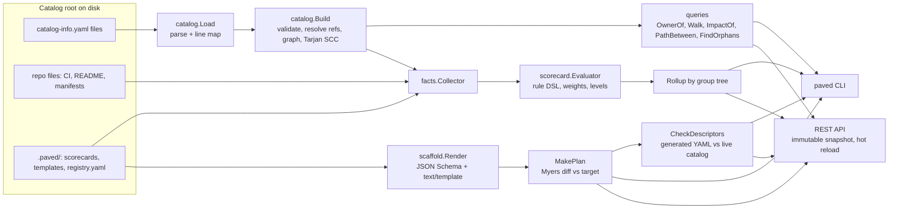

# paved

**An internal-developer-platform core in Go: a software catalog with a relation graph, a template
scaffolder with dry-run diffs, and scorecards with team rollups, behind one CLI and a REST API.**

Platform teams usually adopt this trio piecemeal (a Backstage catalog, a cookiecutter repo, a
spreadsheet of "production readiness" checks). `paved` implements the three as one small,
dependency-light binary that reads the same `catalog-info.yaml` files Backstage does, so you can
answer *who owns X*, *what breaks if Y goes down*, *does this new service meet the bar* and
*which team needs help* from a laptop or a CI job, offline.

It is for platform engineers who want those answers in a pipeline.

[](https://github.com/guneshm03/paved/actions/workflows/ci.yml)

> Status: not yet used against a real organisation's catalog. Everything in the fixture monorepo
> (teams, services, package names, registry dates) is invented; see [DATA.md](DATA.md).

## Features

| Area | Capability |
|---|---|
| **Catalog** | Discovers `catalog-info.yaml` (multi-document) under a root; supports the Backstage subset **Component, API, System, Group, Resource**; reference resolution with Backstage's default-kind rules; **line-accurate validation** (26 diagnostic codes: dangling / mis-typed / self references, duplicates, required fields, group-hierarchy cycles and multiple parents, `dependsOn` cycles, bad names, tags, links, unknown fields). |
| **Graph** | Typed relation graph with inverses (`ownedBy/ownerOf`, `dependsOn/dependencyOf`, `providesApi/apiProvidedBy`, `consumesApi/apiConsumedBy`, `partOf/hasPart`, `childOf/parentOf`, `subcomponentOf`). Queries: **who owns X** (direct, inherited via parent component or system, plus the escalation chain up the group tree), **what depends on Y** (transitive, depth-limited, *through API consumption*), dependencies, blast radius grouped by owning team, shortest dependency path, owned-by-group (recursive). Export to Graphviz DOT and Mermaid. |
| **Orphans** | `no-owner`, `no-system`, `unprovided-api`, `unused-resource`, `empty-group`. |
| **Scaffolder** | Templates = JSON-Schema parameters + skeleton directory. Path templating (a segment that renders empty skips the file - conditional files and directories), `.tmpl` content rendering with a deterministic helper set, **dry-run plan with unified diffs** (own Myers implementation), conflict-safe apply (`--force` to overwrite), path-traversal guards, and **validation of the generated `catalog-info.yaml` against the live catalog** before anything is written. |
| **Scorecards** | YAML rules over repository facts (`ci.present`, `ci.runsTests`, `readme.words`, `oncall.link`, `owner.resolved`, `deps.outdatedRatio`, `deps.libyears`, ... 34 facts) with `all/any/not` and 10 operators; weights, levels (bronze/silver/gold), remediation text; **team rollups up the group hierarchy**; text, Markdown and JSON reports. Dependency freshness is computed offline from `go.mod` / `package.json` / `requirements.txt` against a registry snapshot (outdated ratio, majors behind, **libyears**). |
| **Interfaces** | `paved` CLI (exit codes usable in CI) and a JSON REST API (`paved serve`) with hot reload. |

## Architecture



Packages (`internal/`): `catalog` (model, parser, validation, graph, queries, orphans, export),
`schema` (JSON Schema subset), `scaffold` (templates, render, plan/apply), `textdiff` (Myers
diff), `facts` (repo facts, manifests, registry, libyears), `version` (version precedence),
`scorecard` (rule DSL, evaluation, rollup, formats), `workspace` (wires a root to its config),
`api` (HTTP), `cli` (commands). See [docs/ARCHITECTURE.md](docs/ARCHITECTURE.md) for the
algorithms and their complexity.

## Quickstart

Requires Go 1.24+ (no other runtime dependency; the only module dependency is `go.yaml.in/yaml/v3`).

```sh
make build                                    # -> bin/paved
export PAVED_ROOT=fixtures/acme-monorepo      # or pass --root on every command

bin/paved catalog validate                    # exit 1: one deliberate error in the fixture
bin/paved graph owner recommendations-ml      # who owns X
bin/paved graph dependents resource:payments-db   # what depends on Y
bin/paved score run production-readiness --details
bin/paved scaffold run go-service --dry-run \
  --set name=invoice-service --set "description=Generates and sends customer invoices." \
  --set owner=team-payments
bin/paved serve --addr 127.0.0.1:8080         # REST API
```

`make check` runs the whole gate; `make demo` runs the scripted end-to-end demo below.

### CLI reference

| Command | Purpose |
|---|---|
| `catalog validate [--strict] [--format json]` | all diagnostics; exit 1 on errors (or warnings with `--strict`) |
| `catalog list [--kind --type --lifecycle --owner --system --tag]` | filtered listing |
| `catalog get <ref>` · `catalog orphans` · `catalog stats` · `catalog export [--format dot\|mermaid]` | inspect |
| `graph owner <ref>` | direct / inherited owner and escalation chain |
| `graph dependents <ref> [--direct] [--depth N]` · `graph dependencies <ref>` | upstream / downstream walks |
| `graph impact <ref>` · `graph path <from> <to>` · `graph owned <group> [--recursive]` | blast radius, path, ownership |
| `scaffold list` · `scaffold show <t>` · `scaffold run <t> [--set k=v]... [--values f] [--dry-run] [--target dir] [--force]` | templates |
| `score list` · `score run <card> [--format text\|md\|json] [--details] [--min-score N]` · `score rollup <card>` | scorecards |
| `score facts <ref>` · `score deps <ref>` | the facts behind a score; dependency freshness table |
| `serve [--addr]` | REST API |

References accept `kind:namespace/name`; kind may be omitted when the name is unambiguous.
Exit codes: `0` ok, `1` findings (validation errors, `--min-score` breaches, invalid generated
descriptor), `2` usage, `3` runtime error.

### REST API

`GET /healthz`, `/api/v1/stats`, `/api/v1/entities?kind=&type=&lifecycle=&owner=&system=&tag=`,
`/api/v1/entities/{kind}/{ns}/{name}` and its `/owner`, `/dependents?transitive=&depth=`,
`/dependencies`, `/impact`, `/facts`, `/owned?recursive=` sub-resources, `/api/v1/diagnostics?severity=`,
`/api/v1/orphans`, `/api/v1/scorecards`, `/api/v1/scorecards/{name}[?format=markdown]`,
`/api/v1/scorecards/{name}/rollup`, `/api/v1/templates[/{name}]`;
`POST /api/v1/templates/{name}/dry-run` (body `{"values": {...}}`) and `POST /api/v1/reload`.
Errors use one envelope: `{"error": {"code", "message", "details"}}` (404/405 included).
The API never writes files: applying a template is a deliberate local CLI action.

## Demo (real output)

`make demo` builds the binary and runs [scripts/demo.sh](scripts/demo.sh) against
[fixtures/acme-monorepo](fixtures/acme-monorepo) (29 entities across 13 descriptor files, 8
services + 1 library with varied CI/README/on-call/dependency hygiene, deliberate problems
documented in its [README](fixtures/acme-monorepo/README.md)). Excerpts, pasted from a run:

```text
== 5. What depends on the payments database? (through API consumption too)
$ paved graph dependents resource:payments-db
dependents of resource:default/payments-db: 3
  [1] component:payments-service               via dependsOn                    payments-db -> payments-service
  [2] component:checkout-web                   via api:default/payments-api     payments-db -> payments-service -> checkout-web
  [2] component:payments-sdk                   via api:default/payments-api     payments-db -> payments-service -> payments-sdk

== 6. Blast radius of the ledger service, grouped by team to page
$ paved graph impact ledger-service
impact of component:default/ledger-service: 4 dependents across 2 teams
  group:team-growth            component:checkout-web
  group:team-payments          component:payments-service, component:payments-sdk
  (unowned)                    component:legacy-reporting

== 8. Production-readiness scorecard
$ paved score run production-readiness --details
Scorecard: Production readiness (production-readiness)
Entities: 6   Mean score: 78.9   Levels: gold=2 silver=2 bronze=1 none=1

ENTITY                         OWNER                SCORE  LEVEL   FAILED RULES
component:checkout-web         group:team-growth     46.7  none    ci-runs-tests,readme,oncall,deps-fresh
component:catalog-service      group:team-growth     53.3  bronze  has-ci,ci-runs-tests,deps-fresh
component:ledger-service       group:team-payments   86.7  silver  deps-fresh
component:notification-worker  group:team-platform   86.7  silver  readme
component:auth-service         group:team-platform  100.0  gold    -
component:payments-service     group:team-payments  100.0  gold    -
...
component:checkout-web (46.7):
  x ci-runs-tests: ci.runsTests = false, want == true
    fix: Make CI run go test / pytest / npm test / make check.
  x readme: readme.words = 7, want >= 60
...
== 9. Team rollup (group hierarchy)
$ paved score rollup production-readiness
TEAM                   OWNED  MEAN  SUBTREE  SUBTREE MEAN  MIN   LEVELS                           TOP FAILING
group:engineering      0      -     6        78.9          46.7  gold=2 silver=2 bronze=1 none=1  deps-fresh(3) ci-runs-tests(2)
  group:team-growth    2      50.0  2        50.0          46.7  bronze=1 none=1                  ci-runs-tests(2) deps-fresh(2)
  group:team-payments  2      93.4  2        93.4          86.7  gold=1 silver=1                  deps-fresh(1)
  group:team-platform  2      93.4  2        93.4          86.7  gold=1 silver=1                  readme(1)

== 12. Dry run with a typo in the owner is caught before anything is written
$ paved scaffold run go-service --dry-run --set owner=team-paymnets ...
paved: generated descriptor has 1 error(s)
check: services/invoice-service/catalog-info.yaml:11: error [dangling-ref] spec.owner references group:default/team-paymnets, which is not in the catalog

== 13. Apply into a scratch copy of the monorepo, then re-validate and re-score
wrote 8 files under .demo-out/acme
entities: 31
...
component:invoice-service      group:team-payments   93.3  good   techdocs
```

The full transcript (14 steps, including the scaffold diff and the REST calls) is reproduced
by `make demo`.

## Design decisions

The full log with costs is in [DECISIONS.md](DECISIONS.md). The load-bearing ones:

- **Backstage-compatible input, own semantics where Backstage is silent.** Descriptor format,
  reference syntax and default kinds follow Backstage, so existing `catalog-info.yaml` files load.
  `dependsOn` requires an explicit kind (as in Backstage); owners must be Groups (`User` is not
  modelled).
- **"What depends on Y" follows APIs.** If Y provides an API that X consumes, X depends on Y.
  Without this, the payments database would appear to have one dependent instead of three.
- **Ownership inheritance.** When `spec.owner` is missing or dangling, the effective owner is
  inherited from the parent component, then the system, and the answer says so (`via`,
  `inheritedFrom`) rather than silently substituting.
- **Validation never stops loading.** Problems become diagnostics with file:line; only I/O errors
  fail a load. Dangling references produce no edge, so queries stay well-defined.
- **Unsupported JSON-Schema keywords are compile errors**, so a template never appears to
  validate something it does not.
- **The scaffolder is deterministic** (no clock/env helpers) - that is what makes golden tests and
  reviewable dry-run diffs possible.
- **Facts are offline.** Freshness uses a registry snapshot file, not live registries, so scores are
  reproducible and CI needs no network.
- **One dependency** (`go.yaml.in/yaml/v3`); diffing, schema validation, version ordering, the rule
  DSL and HTTP routing are implemented here or use the standard library.

## Tests, coverage and benchmarks

Every number below comes from the command next to it (Apple M1 Pro, Go 1.27.1).

| What | Command | Result |
|---|---|---|
| Full gate | `make check` | gofmt, `go vet`, golangci-lint (0 issues), `go test -race` on 10 packages, coverage gate - passes |
| Coverage (internal/..., statements) | `make check` (runs `scripts/coverage.sh coverage.out 85`) | **94.6%** (threshold 85%) |
| Catalog build, 2,150 generated entities incl. YAML parse | `make bench` → `BenchmarkBuild1000` | 43.8 ms/op |
| Transitive "what depends on" from a shared resource | `make bench` → `BenchmarkWalkUpstream1000` | 0.94 ms/op |
| Orphan scan of the same catalog | `make bench` → `BenchmarkFindOrphans1000` | 1.6 ms/op |
| Myers diff, 1,000 lines with 10 edits | `make bench` → `BenchmarkLines1000Lines10Edits` | 0.10 ms/op |

Test kinds: table-driven unit tests per diagnostic code and API endpoint; graph-query tests
(who owns X, what depends on Y, impact, paths) asserted against the fixture; **golden tests** for
three template renders, a dry-run diff against an existing service, and the text/rollup/Markdown
scorecard reports (`go test ./internal/scaffold ./internal/scorecard -update` rewrites them);
**property tests** (upstream and downstream walks mirror each other on random catalogs; the
diff is minimal, checked against an O(NM) LCS); **fuzz targets** for reference and descriptor
parsing (`make fuzz`); and an integration test that renders the Go template and runs `go vet` and
`go test` on the generated service.

## Limitations

- **Catalog subset only.** No `User`, `Domain` or `Location` kinds, no `$text`/`$yaml`
  substitution resolution (the reference is kept as a string), no entity processors/providers and no
  persistence: the catalog is rebuilt from disk on every CLI call and on API reload.
- **Facts are file-based heuristics.** `ci.runsTests` is a regex over workflow files; README
  quality is a word count; facts are read from the descriptor's directory only (no git history, no
  CI run results, no live on-call system). They can be gamed.
- **Freshness depends on the snapshot.** The bundled registry snapshot is synthetic; real use needs
  a job that exports real release histories into `registry.yaml`. npm/PyPI ranges are reduced to
  their lower bound; lockfiles are not read.
- **JSON Schema is a subset** (no `$ref`, `oneOf/anyOf/allOf`, `if/then`, `patternProperties`,
  object-valued `additionalProperties`).
- **No auth on the API**; it is read-only (except reload) and meant for localhost or behind a
  gateway. No pagination.
- **Scale is laptop-scale.** Benchmarks above go to ~2k entities; nothing has been measured on a
  real organisation's catalog.

## Project layout

```text
cmd/paved/            entry point
internal/catalog      model, parser, validation, graph, queries, orphans, export
internal/scaffold     templates, render, plan/apply     internal/textdiff  Myers diff
internal/facts        repo facts, manifests, registry   internal/version   version precedence
internal/scorecard    rule DSL, evaluation, rollup      internal/schema    JSON Schema subset
internal/workspace    root + config wiring              internal/api, cli  REST API and commands
fixtures/             acme-monorepo sample catalog      scripts/           demo and coverage gate
docs/                 architecture notes                DECISIONS.md       design decisions
```

## Roadmap

- `Location` entities and `$text` substitution so API definitions are loaded and linted.
- Pluggable fact providers (CI status via API, PagerDuty schedule check) with caching.
- Scorecard history (store reports, show trend per team).
- Template steps beyond file rendering (e.g. "register in catalog" as a PR) and a `paved init`.
- Pagination and ETags on the API; an OpenAPI description of it.

## License

MIT, see [LICENSE](LICENSE).

## Maintainer

Maintained by **Gunesh Mahajan**, Product Manager.

- Email: [guneshmahajan574@gmail.com](mailto:guneshmahajan574@gmail.com)
- LinkedIn: [linkedin.com/in/guneshm007](https://www.linkedin.com/in/guneshm007/)