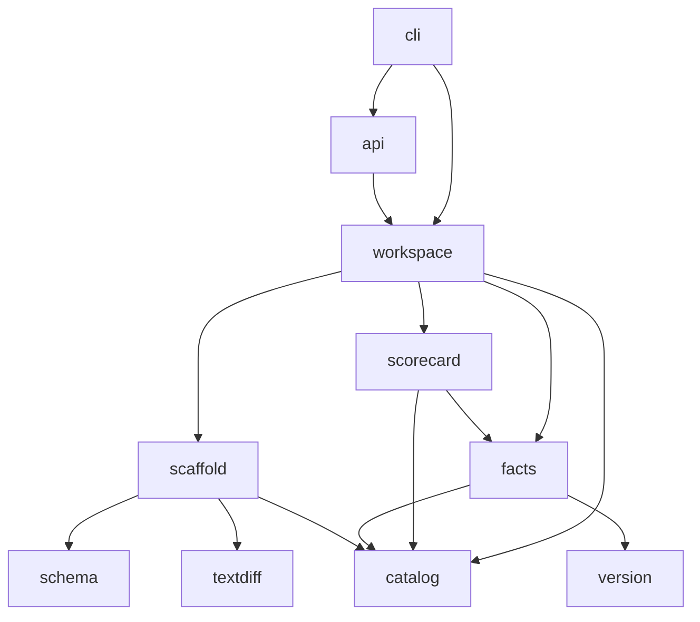

# Architecture

paved is a single Go module (`github.com/guneshm03/paved`) with one binary, `cmd/paved`. All
logic lives in `internal/` packages with one-way dependencies:



| Package | Responsibility | Key types |
|---|---|---|
| `catalog` | descriptor parsing with line maps, validation, reference resolution, relation graph, queries, orphans, DOT/Mermaid export | `Entity`, `Ref`, `Catalog`, `Graph`, `Diagnostic`, `Ownership`, `Hit`, `Impact`, `Orphan` |
| `schema` | JSON Schema subset: compile (from YAML nodes, order-preserving), validate, defaults, CLI coercion | `Schema`, `ValidationError`, `ParamDoc` |
| `scaffold` | template loading, skeleton rendering, dry-run plan, apply, generated-descriptor checks | `Template`, `Result`, `Plan`, `Change` |
| `textdiff` | Myers O(ND) line diff, unified format | `Op`, `Lines`, `Unified` |
| `facts` | repository facts per entity, manifest parsing, registry snapshot, freshness/libyears | `Collector`, `Facts`, `Registry`, `Freshness` |
| `version` | version parsing and semver precedence across Go/npm/PyPI styles | `Version`, `Compare` |
| `scorecard` | rule DSL, weighted scoring, levels, team rollups, text/Markdown output | `Scorecard`, `Condition`, `Evaluator`, `Report`, `TeamRollup` |
| `workspace` | `paved.yaml` config; opens catalog + scorecards + templates + registry together | `Workspace`, `Config` |
| `api` | HTTP handlers over an immutable snapshot with atomic reload | `Server` |
| `cli` | sub-command dispatch, flags, formatting, exit codes | `Run` |

## Catalog pipeline

1. **Discover** (`Discover`): walk the root, skipping hidden directories (`.git`, `.paved`, …),
   `node_modules` and `vendor`; collect `catalog-info.yaml|yml`. O(files).
2. **Parse** (`ParseDescriptors`): stream YAML documents with `yaml.Node`, so every key and
   sequence item gets a line number recorded under a dotted path (`spec.dependsOn.1`). Unknown or
   kind-inappropriate fields become warnings; type mismatches become errors with the exact line.
   A syntax error stops that file only (the YAML decoder cannot resynchronise).
3. **Build** (`Build`):
   - de-duplicate by reference (first declaration wins, later ones are `duplicate-entity` errors);
   - per-entity validation (`validateEntity`): apiVersion, name/namespace syntax, tags, links,
     required spec fields per kind, lifecycle and API type vocabularies;
   - reference resolution (`resolveRelations`): each relation field has a default kind and an
     allowed kind set (`owner` → Group, `dependsOn` → Component|Resource with kind required, …).
     Malformed, mis-typed, self and dangling references are errors and add **no** edge, so the
     graph only ever contains resolvable targets;
   - every edge is stored with its inverse (`ownedBy`/`ownerOf`, …), deduplicated, and adjacency
     lists are sorted for deterministic output;
   - group hierarchy checks (multiple parents, parent not listing the child) and **cycle
     detection with Tarjan's SCC algorithm** for both the group tree (error) and `dependsOn`
     (warning). For each SCC a concrete cycle is extracted by BFS from its smallest member.

   Complexity: O(E log E) for sorting adjacency lists, O(V + E) for everything else, where V is
   entities and E declared relations.

## Queries

All queries read the immutable graph; none allocate more than O(V).

- **OwnerOf** — direct owner from the `ownedBy` edge; otherwise walk `subcomponentOf` then
  `partOf` parents (cycle-guarded) until an owned ancestor is found, reporting `via` and
  `inheritedFrom`. The escalation chain is the `childOf` path above the effective owner.
  O(depth of nesting + depth of group tree).
- **Walk** (dependents/dependencies) — breadth-first search with a visited set, so each entity is
  reported once at its shortest distance, with the full path. A hop is either a `dependsOn` edge
  or an *API hop*: downstream, X consumes API A and P provides A ⇒ X → P; upstream is the exact
  mirror (P provides A, X consumes A ⇒ X is a dependent of P). Starting at an API steps directly to
  its providers or consumers. `MaxDepth` and `Transitive=false` bound the BFS. O(V + E) per call;
  each hit carries its path, so output size is O(V · depth) in the worst case.
- **ImpactOf** — upstream walk plus `OwnerOf` for each dependent, grouped by effective owner.
- **PathBetween** — downstream BFS; BFS order guarantees the shortest path.
- **OwnedBy(recursive)** — BFS over `parentOf` for descendants, then `ownerOf` targets.
- **FindOrphans** — one pass over entities using the above primitives. O(V · nesting depth).

A property test generates random layered catalogs and checks that every downstream pair (a → b)
appears as an upstream pair (b ← a) and vice versa, and that direct hits are a subset of
transitive ones.

## Scaffolder

```
template.yaml (apiVersion paved.dev/v1, kind Template)
  spec.output       path template for the output directory, e.g. services/{{ .name }}
  spec.parameters   JSON Schema (type: object)
skeleton/           files to render
```

1. **Values**: defaults are applied (deep-copied, recursively into nested objects), then the
   whole object is validated; every violation is returned with its JSON pointer. Declared
   optional parameters without a default are added as `nil`, so `{{ if .x }}` works while
   `missingkey=error` still rejects references to undeclared names.
2. **Render**: every path *segment* is a template; a segment that renders empty drops the file,
   which gives conditional files and directories (`{{ if .withDatabase }}migrations{{ end }}/…`).
   Files ending in `.tmpl` have their content rendered and the suffix removed; others are copied
   byte-for-byte (so binary assets and files that contain `{{` literally are safe). Rendered
   paths are cleaned and rejected if absolute, containing `\`, or escaping the output root
   (`..`). Two skeleton files rendering to the same path is an error. The helper set (`kebab`,
   `snake`, `camel`, `pascal`, `title`, `join`, `default`, `indent`, `toInt`, `has`, …) reads no
   clock, environment or filesystem, so renders are reproducible.
3. **Plan**: each rendered file is compared with the target: `create`, `update` or `unchanged`;
   text files get a unified diff (`textdiff`), binary ones are flagged. `Apply` writes creates and
   — only with `force` — updates; on any conflict without force nothing is written.
4. **CheckDescriptors**: rendered `catalog-info.yaml` files are parsed and built *together with
   the existing catalog*, and only diagnostics located in the new files are returned. This is how
   a typo'd owner or a name collision is caught at dry-run time. Entities declared in a descriptor
   the render is about to overwrite are dropped first, so re-scaffolding an existing service
   (`--force`) replaces its declaration instead of reporting a self-`duplicate-entity`; when the
   CLI writes to a `--target` other than the catalog root, `CheckDescriptorsAlongside` keeps
   every loaded entity. The CLI refuses a real apply when a check is an error.

### Myers diff

`textdiff.Lines` is Myers' greedy O((N+M)·D) shortest-edit-script algorithm with a stored trace
(O(D²) memory) and backtracking. Hunks are built with 3 lines of context and merged when the gap
between changes is ≤ 2·context, matching `diff -u`. A property test checks, on 500 random inputs,
that the script reconstructs both sides and that its size equals N + M − 2·LCS (i.e. it is
minimal), using an O(NM) LCS as the oracle.

## Facts and scorecards

`facts.Collector.Collect(entity)` reads the descriptor's directory and returns a flat
`map[string]any` (bool, float64, string, []string): `entity.*`, `owner.*`, `system.present`,
`api.*`, `ci.*` (GitHub Actions workflows, `.gitlab-ci.yml`, `Jenkinsfile`; `ci.runsTests` by
regex for common test commands), `readme.*` (prose words excluding fenced code; headings),
`oncall.*` (`paved.dev/oncall-url` annotation or a link of type `oncall`), `pagerduty.present`,
`techdocs.present`, `codeowners.present`, and `deps.*`.

**Dependency freshness.** Manifests (`go.mod` require lines and blocks, `package.json`
dependencies/devDependencies, `requirements.txt` pins and ranges) are parsed into dependencies.
For each one, the registry snapshot gives the release history (sorted with `version.Compare`):

- `latest` = highest non-prerelease release;
- `outdated` if the declared version (range operators stripped to their base) is lower;
- `majorsBehind` = latest major − current major (Go `/vN` module suffixes are folded onto one
  history so this works across major-version module paths);
- **libyears** = release date of latest − release date of the newest release ≤ current (binary
  search). This is the libyear metric (libyear.com).

Summaries: `deps.total|evaluated|outdated|unknown|unpinned|outdatedRatio|majorsBehind|libyears`.

**Rules** are YAML: `{fact: x, <op>: value}` with `equals, notEquals, gt, gte, lt, lte, matches,
exists, in, contains`, combined with `all`, `any`, `not`. Operand types are checked at load time
(numbers for comparisons, compilable regexes, lists for `in`). A missing fact fails the rule with
reason "x is not available" except under `exists`. Every evaluation returns a human-readable
reason (`readme.words = 7, want >= 60`) and failing rules carry the rule's remediation text.

**Score** = Σ weights of passing rules / Σ all weights × 100, rounded to 0.1; the **level** is the
highest level whose `minScore` ≤ score. Facts are cached per entity inside an `Evaluator`, so
several scorecards cost one collection pass.

**Rollup** groups results by effective owner, then walks the group forest depth-first from root
groups (siblings sorted). Each row has `direct` stats (entities the team owns) and `total` stats
(its whole subtree): count, mean, min, level distribution, most-failed rules. Groups in a
hierarchy cycle (already a validation error) are still listed once. Unowned entities form a final
`(unowned)` row. O(G · D + N) for G groups of depth D and N results.

## HTTP API

`api.Server` holds a pointer to an immutable `snapshot` (workspace + pre-evaluated scorecard
reports) behind an `RWMutex`. `POST /api/v1/reload` builds a new snapshot off to the side and
swaps it in only on success, so a broken edit on disk never takes the API down. Handlers use Go
1.22 `ServeMux` method/path patterns; a wrapper converts the mux's plain-text 404/405 into the JSON
error envelope (keeping `Allow`). Middleware: request logging via `log/slog`, panic recovery.
Request bodies are capped at 1 MiB and decoded with `DisallowUnknownFields`.

## Error handling and logging

- Domain errors are typed (`catalog.NotFoundError`, `catalog.AmbiguousRefError`,
  `catalog.RefError`, `scaffold.ParamError`, `scaffold.ConflictError`, `scaffold.PathError`,
  `schema.CompileError`, `workspace.NotFoundError`) and mapped to HTTP statuses / CLI exit codes
  with `errors.As`.
- Logging is structured (`log/slog`, text handler to stderr); the CLI defaults to `warn`, the
  server to `info` (request lines with status and duration).
